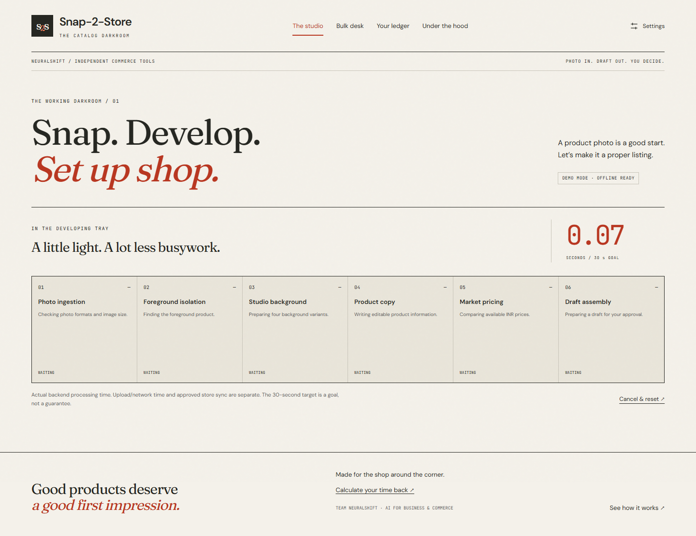
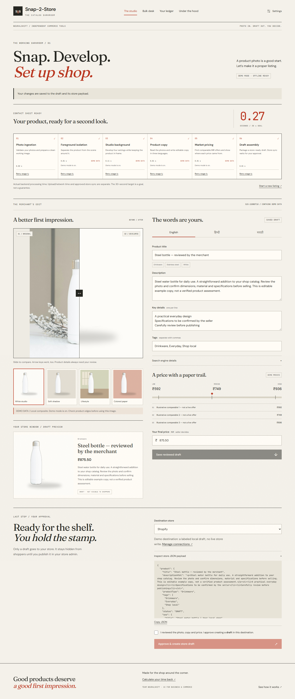
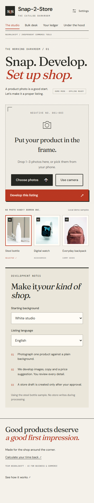

# Snap-2-Store

**Turn a product photo into a listing you can review, edit, and approve.**


[Try the live demo](https://snap-2-store.vercel.app) · [Screenshots](#screenshots) · [Get started](#getting-started) · [Contribute](#contributing)

Snap-2-Store is a product-listing studio for independent sellers, local makers, and small commerce teams. Upload a photo, develop four image variants, edit copy in English, Hindi, or Marathi, review INR pricing, and explicitly approve a Shopify or WooCommerce draft.

Built by **Team NeuralShift** for AI for Business and Commerce. The interface takes its cues from a photographic darkroom: warm paper, ink, tomato accents, and developing trays.

> **Demo status:** The hosted app runs in labeled demo mode. Images use local compositing or precomputed sample masks; copy and prices are illustrative. Demo approval creates a saved demo receipt. Live AI and store credentials are not configured.

**Contents:** [Features](#features) · [Screenshots](#screenshots) · [Getting started](#getting-started) · [Docker](#docker-compose) · [Vercel](#vercel-deployment) · [Usage](#using-the-app) · [Configuration](#configuration-and-providers) · [Tests](#testing) · [Troubleshooting](#troubleshooting) · [Contributing](#contributing) · [License](#license-and-credits)

## Features

- **Photo input:** one to three photos per listing, file picker, camera input, previews, and upload validation.
- **Six visible stages:** ingestion, foreground isolation, studio background, product copy, market pricing, and draft assembly, with measured timings and progress events.
- **Merchant editing:** before/after comparison, four image variants, English/Hindi/Marathi copy, tags, SEO fields, and an editable INR price.
- **Approval before store writes:** review the exact payload before creating a Shopify or WooCommerce draft. Nothing is automatically published to shoppers.
- **Bulk work and history:** process a shelf of products, review individually or in a batch, and return to saved drafts and receipts.
- **Recovery and transparency:** cancellation, stage retries, visible fallback reasons, and clear demo-data labels.
- **Accessible interface:** keyboard comparison controls, responsive layouts, local fonts, and reduced-motion support.
- **Local or hosted operation:** run without provider keys locally, or deploy Next.js and FastAPI together with durable cloud storage.

The pipeline prepares a reviewable draft in six steps. Merchant approval is a separate action; the 30-second processing target is a goal, and every run displays its actual elapsed time.

## Screenshots

These screenshots show the local production build in **demo mode**. Sample images, copy, prices, and timing belong to that demo run. Expand a preview or click its image to inspect the full capture.

<details>
<summary><strong>Landing page — the catalog darkroom</strong></summary>

[](docs/images/landing.png)

</details>

<details open>
<summary><strong>Studio — six processing stages and a measured stopwatch</strong></summary>

[](docs/images/processing.png)

</details>

<details>
<summary><strong>Review — before/after, multilingual editing, pricing, and approval</strong></summary>

[](docs/images/review.png)

</details>

<details>
<summary><strong>Mobile — the studio at 390 pixels wide</strong></summary>



[Open the full mobile screenshot](docs/images/mobile.png)

</details>

## Tech stack

| Layer            | Implementation                                                                  |
| ---------------- | ------------------------------------------------------------------------------- |
| Frontend         | Next.js App Router, React, TypeScript, Tailwind CSS                             |
| API and progress | FastAPI, Pydantic, server-sent events                                           |
| Image processing | Pillow; CPU rembg in the full local install; optional hosted SAM/FLUX adapters  |
| Local execution  | BackgroundTasks or Redis/RQ; filesystem records and media                       |
| Vercel execution | Vercel Services; managed Upstash Redis records/locks; private Vercel Blob media |
| Verification     | pytest, Playwright, axe accessibility checks, TypeScript, and production builds |

## Getting started

Start with demo mode. No provider keys, GPU, Redis server, or store account is needed for the local sample flow.

Clone the public source repository into an app-named directory:

```sh
git clone https://github.com/PranavP2207/project2.0.git snap-2-store
cd snap-2-store
```

### Windows PowerShell

Prerequisites: Node.js 24 (20.9+ supported by Next.js), Python 3.11–3.13, and npm. Python 3.11 and Node 24 were used here. No Redis, GPU, provider keys or store account is needed for the offline demo.

Run from this repository root:

```powershell
if (-not (Test-Path .env)) { Copy-Item .env.example .env }
python -m venv .venv
.venv\Scripts\python -m pip install -r backend/requirements.lock.txt
npm ci
.venv\Scripts\python -m uvicorn backend.app.main:app --host 127.0.0.1 --port 8000
```

In a second terminal, from the same root:

```powershell
npm run dev
```

Open [the app](http://127.0.0.1:3000). FastAPI health is [here](http://127.0.0.1:8000/api/health), and its [interactive API docs](http://127.0.0.1:8000/docs) document request schemas. Keep `DEMO_MODE=true` for the first run.

### macOS / Linux

```sh
cp -n .env.example .env
python3.11 -m venv .venv
.venv/bin/python -m pip install -r backend/requirements.lock.txt
npm ci
.venv/bin/python -m uvicorn backend.app.main:app --host 127.0.0.1 --port 8000
# Second terminal:
npm run dev
```

For a production frontend instead of the development server:

```sh
npm run build
npm start
```

The frontend proxies `/api/*` and `/media/*` to FastAPI. If using another backend address, set `BACKEND_URL` in the frontend process environment before building/running (for example `$env:BACKEND_URL='http://127.0.0.1:8001'` in PowerShell). Secrets never belong in a `NEXT_PUBLIC_*` variable.

## Docker Compose

With Docker Desktop's Linux engine or Docker Engine running:

```sh
cp .env.example .env
# Windows: Copy-Item .env.example .env (only if it does not already exist)
docker compose up --build
```

The frontend is at `http://127.0.0.1:3000`. Compose starts Next.js, FastAPI, Redis and an RQ worker. Ports bind to loopback. `snap-data` retains jobs, images, cache and shared `data/config/.env` settings; `redis-data` retains the queue. Settings saved through the UI are read by both the API and worker and take precedence over startup environment values. `docker compose down` stops the app while retaining data; do not add `-v` unless you intend to delete that data.

The backend and worker install the Python lock file. The frontend installs `package-lock.json`; fonts and sample photos are local assets. Container image builds need Internet access for dependencies; the built demo needs no external services.

Compose configuration was validated here. The Docker engine was unavailable, so the complete container build was not executed; the manual production-server path was tested instead.

## Vercel deployment

Live demo: **https://snap-2-store.vercel.app**. Uploads, all six processing stages, private media/history, saved edits and an approved demo draft have been verified on the hosted services. Live AI and store credentials are not configured.

Canonical source: [PranavP2207/project2.0](https://github.com/PranavP2207/project2.0). Vercel is linked to this repository's `main` production branch. A push to `main` automatically built and deployed successfully; the public URL above points to that GitHub-triggered deployment.

An additional private repository is available under the app name: [PranavP2207/snap-2-store](https://github.com/PranavP2207/snap-2-store). The local `snap-2-store` remote points there; `origin` and Vercel continue to use `project2.0`. Push explicitly to both remotes when updating both repositories.

The deployment configuration runs Next.js and FastAPI together using Vercel Services. `vercel.json` routes `/api/*` and `/media/*` to Python and all other paths to Next.js. `server.py` selects the pinned, lean Python runtime in root `requirements.txt`; the full local environment retains CPU rembg in `backend/requirements.lock.txt`. Sample photos and their masks are explicitly included in the Python function.

The hosted demo uses a free managed Upstash Redis store for records and distributed locks, plus a private Vercel Blob store for original/processed photos. Browser workspaces are isolated by a signed, secure, HTTP-only cookie. Clearing that cookie or using another browser starts a separate ledger; this is anonymous workspace isolation, not account authentication. Media reads verify workspace ownership before serving an image. Unique image paths on retries avoid stale Blob/CDN reads.

For a new deployment, link the project, provision/connect a **private** Blob store and **free** Upstash Redis integration, and set the deployment-only variables listed in `.env.cloud.example`. Leave automatic paid database upgrades disabled. Vercel/Upstash may require the account owner to accept marketplace terms. Set `CLOUD_MODE=true`, `DEMO_MODE=true`, and a cryptographically random `SESSION_SECRET` in the Vercel project environment for Production and Preview. The connected stores supply their own credentials. Keep all real values out of source control and browser bundles.

```sh
vercel link
vercel deploy --prod
```

Hosted integration settings are read-only and managed through Vercel environment settings; the shared demo does not accept visitors' API/store credentials. The demo makes no real store writes. For a private live merchant installation, add authentication and an explicit public/signed media-import strategy before enabling store credentials: anonymous private-workspace image URLs require the browser cookie, which a store importer cannot supply.

Large picker/camera photos are reduced before upload so up to three files fit the request limit. Cloud processing uses FastAPI background tasks within a 300-second function window; timed-out records become retryable. This is bounded request-based processing, not a continuously running RQ worker. Local/Docker Redis+RQ operation remains available for heavier processing. Cloud price-search caching is best-effort per instance; durable job records and media use the connected stores.

Verify an already deployed **demo** with:

```powershell
.venv\Scripts\python -m backend.scripts.smoke_cloud https://your-app.vercel.app
```

This refuses non-demo mode and checks all seven pages, six-stage sample processing, private media/history, saved edits, explicit approved demo drafts, idempotency and a returning visitor. It creates only an isolated sample listing and no live store product. Vercel project metadata confirms the canonical GitHub repository and production branch above; CLI deployments also remain available independently of the Git integration.

## Using the app

| Route             | What it does                                                                         |
| ----------------- | ------------------------------------------------------------------------------------ |
| `/`               | Editorial product story, projected impact and measured-time calculator               |
| `/create`         | 1–3 photos/camera/samples → six timed stages → review/edit → approved store draft    |
| `/bulk`           | Up to 20 single-photo products; queue, individual review and selected-batch approval |
| `/history`        | Durable records, status filters, draft review links and store receipts               |
| `/settings`       | Demo toggle, provider selections, server-only credentials, store connection tests    |
| `/impact`         | Monthly savings modeled from actual stored processing times                          |
| `/under-the-hood` | Inline SVG architecture, tool roles, feasibility, scale and roadmap                  |

**Review is the approval boundary.** Stage 6 assembles the draft payload; it does not create a store product. Save any edits, select a destination, check the approval box and press **Approve & create store draft**. The result says whether it is a local demo record or a real hidden store draft. “Draft synced” in history does not mean visible to shoppers.

A retry reruns the chosen stage and all later dependent stages, replacing the draft. Cancel/reset discards late UI results and cancels a known active job. Invalid files are rejected before a job is created. Failed stages can be retried. Local tasks interrupted by a backend restart become retryable failed jobs; Redis jobs need a running worker.

## Configuration and providers

| Capability | Demo / fallback                                                                              | Configured live path                                       |
| ---------- | -------------------------------------------------------------------------------------------- | ---------------------------------------------------------- |
| Isolation  | Bundled rembg-precomputed sample cutouts; general uploads use a labeled edge-color heuristic | Hosted SAM on fal.ai/Replicate; local CPU rembg fallback   |
| Background | Actual Pillow compositing, four settings                                                     | FLUX Kontext on fal.ai/Replicate                           |
| Copy       | Editable illustrative sample copy in three languages                                         | Gemini Flash, or GPT-4o, with validated strict JSON        |
| Pricing    | Explicitly illustrative INR ticks, no fabricated live links                                  | Tavily or SerpAPI, source URLs and explicit INR extraction |
| Store      | Durable local demo draft with ID/receipt                                                     | Shopify GraphQL or WooCommerce REST, DRAFT only            |

Missing keys and failed model/search calls carry visible **DEMO DATA** badges and reasons. Calls retry with bounded exponential backoff; timings include that work. No artificial sleeps are used to imply AI computation. Demo timing cannot predict live-provider latency or fees.

The exact three bundled input files are recognized by content hash and use their precomputed examples even when uploaded through the file picker. This is fixture recognition, not visual inference. Other uploads receive generic, editable demo copy if vision is unavailable.

Provider contracts, source references and model caveats are in [docs/provider-reference.md](docs/provider-reference.md). Configure `GEMINI_MODEL` or the corresponding provider model setting for a model available to your account.

### Environment setup

Copy `.env.example` once; leave unused credentials empty. For local installations, the settings screen writes changes to the backend `.env`, returns only secret-presence flags, and preserves saved secrets when fields are blank. To revoke a saved credential, clear it in that server `.env` and restart the backend/worker. Local trusted-operator use is the intended scope; there is no multi-user login.

| Setting                                                               | Values / purpose                                                                                   |
| --------------------------------------------------------------------- | -------------------------------------------------------------------------------------------------- |
| `DEMO_MODE`                                                           | `true` for guaranteed offline sample operation; `false` attempts available live providers          |
| `SEGMENTATION_PROVIDER`                                               | `fal`, `replicate`, `rembg`                                                                        |
| `BACKGROUND_PROVIDER`                                                 | `fal`, `replicate`                                                                                 |
| `VISION_PROVIDER`                                                     | `gemini`, `openai`                                                                                 |
| `PRICE_PROVIDER`                                                      | `tavily`, `serpapi`                                                                                |
| `GEMINI_API_KEY`, `OPENAI_API_KEY`                                    | Corresponding vision credentials                                                                   |
| `FAL_KEY`, `REPLICATE_API_TOKEN`                                      | Hosted image-provider credentials                                                                  |
| `REPLICATE_SAM_VERSION`                                               | Required pinned SAM version for Replicate; see provider reference                                  |
| `FAL_SAM_MODEL`, `FAL_BACKGROUND_MODEL`, `REPLICATE_BACKGROUND_MODEL` | Account-available model IDs                                                                        |
| `GEMINI_MODEL`, `OPENAI_MODEL`                                        | Select an available model; GPT-4o default retained                                                 |
| `REMBG_MODEL`                                                         | `u2netp` by default, a small CPU model                                                             |
| `TAVILY_API_KEY`, `SERPAPI_API_KEY`                                   | Corresponding price search credentials                                                             |
| `REDIS_URL`                                                           | Empty uses BackgroundTasks; otherwise Redis/RQ with a visible local fallback on connection failure |
| `STAGE_TIMEOUT_SECONDS`, `STAGE_MAX_ATTEMPTS`                         | Bounded live stage calls, defaults 25 seconds / 2 attempts                                         |
| `PRICE_CACHE_TTL_SECONDS`                                             | Price search TTL, default 3600 seconds                                                             |
| `PUBLIC_BASE_URL`                                                     | Public HTTPS app origin needed for real store image imports                                        |
| `DATA_DIR`                                                            | Shared durable jobs/media/cache location, default `data`                                           |
| `SETTINGS_ENV_FILE`                                                   | Optional server path override, used by Compose for its shared `.env`                               |

`rembg` CPU dependencies are included. Its first use downloads the small model to ignored `data/models`; warm it with the command below before working without network access. The shipped sample cutouts require no model download at runtime.

```powershell
.venv\Scripts\python -m backend.scripts.precompute_samples
```

This regenerates the three bundled cutouts and warms the local rembg model. For a manual Redis worker:

```powershell
# Set REDIS_URL in .env, start Redis, then:
.venv\Scripts\python -m backend.app.worker
```

On Linux RQ uses worker processes; Windows uses SimpleWorker for local development. Clients and the rembg session are shared per process. Background variants execute concurrently; price searches use a durable TTL cache.

## A free Shopify development-store rehearsal

1. Use the [Shopify Dev Dashboard development-store workflow](https://shopify.dev/docs/apps/build/stores/development-stores) to create a development/test store; it is for development, not live merchant selling.
2. Set its currency to **INR**. Create/install an app for that store and grant Admin API product read/write permissions, including `write_products`, through Shopify's current app setup. Keep its Admin API access token private.
3. In Settings, enter `your-shop.myshopify.com` and the token. `SHOPIFY_API_VERSION` defaults to `2026-07` and can be updated to another supported stable version.
4. Host store-accessible media on public HTTPS and set `PUBLIC_BASE_URL`. Shopify must fetch the generated image; localhost cannot work for live image import. The public Vercel demo uses private browser-scoped media, so a live store installation needs an explicit media-import strategy.
5. Turn demo mode off, save, and **test connection**. A successful test checks the shop and INR currency, not a product write.
6. Generate and review a listing, save edits, approve **Shopify**, and inspect the returned Admin product link. The adapter calls `productCreate(status: DRAFT)`, then `productVariantsBulkUpdate` for the final price/SKU. It never calls a storefront publication mutation. If variant update fails, the receipt retains the created product ID and tells you to correct that draft rather than duplicate it.

See the official [draft product creation](https://shopify.dev/docs/api/admin-graphql/latest/mutations/productCreate) and [variant pricing](https://shopify.dev/docs/api/admin-graphql/latest/mutations/productVariantsBulkUpdate) references. App/token creation details can vary with Shopify's current development workflow.

## A WooCommerce test-store rehearsal

1. Create a disposable WordPress development site with [WooCommerce's local development guidance](https://developer.woocommerce.com/docs/getting-started/development-environment/), or a test hosting installation. Install/activate WooCommerce, configure permalinks and set currency to **INR**. Do not use a real payment gateway for this rehearsal.
2. Under WooCommerce's REST API key settings, generate a **Read/Write** consumer key and secret for an appropriate test user. See the [official REST authentication guide](https://developer.woocommerce.com/docs/apis/rest-api/authentication/).
3. Enter the site base URL, consumer key and secret in Settings. HTTPS is required except for explicit localhost test URLs. Test the connection with demo mode off.
4. For image sync, set a public HTTPS `PUBLIC_BASE_URL` that the WordPress server can reach. A purely local test can verify connection, but the app uses a labeled demo draft until public media is configured.
5. Review a listing and explicitly approve WooCommerce. The adapter creates a product with `status: draft`, decimal `regular_price`, image, SKU and attributes. It resolves/creates tag term IDs after approval. SEO fields and category text are retained in `_snap2store_*` metadata; mapping to a particular SEO plugin is store-specific.

WooCommerce defaults to publishing if status is omitted; this app always supplies `draft`. See the [official product contract](https://developer.woocommerce.com/docs/apis/rest-api/v3/products/).

## Testing

Run checks from the repository root after installing dependencies. Browser tests start real frontend/API servers with isolated demo storage and configuration; stop other servers on ports 3000 and 8000 first.

```powershell
.venv\Scripts\python -m pytest -q
npm run typecheck
npm run build
npx playwright install chromium
$env:PLAYWRIGHT_PRODUCTION='true'
npm run test:e2e
```

On macOS/Linux, use `.venv/bin/python` and `PLAYWRIGHT_PRODUCTION=true npm run test:e2e`. Without that flag, browser tests use the development frontend. `PLAYWRIGHT_REUSE_SERVER=true` is only for an already running demo server.

**Verified checkpoint — 17 October 2026:**

| Check                   | Observed result                                                                                                     |
| ----------------------- | ------------------------------------------------------------------------------------------------------------------- |
| Backend                 | 33 pytest tests passed; external provider boundaries are mocked                                                     |
| Frontend                | Production build and TypeScript passed; all seven routes built                                                      |
| Browser                 | 11 existing production-frontend checks passed, plus a separate passing large-photo regression check                 |
| Accessibility           | Automated WCAG A/AA scans reported no violations on all seven routes and the ready review screen                    |
| Hosted demo             | All six stages, private media/history, saved edits, approval, idempotency, and returning-visitor persistence passed |
| Container configuration | Compose configuration validated; Docker engine/image execution was unavailable                                      |

Browser tests regenerate ignored `docs/screenshots/` QA captures. The four curated images in `docs/images/` are versioned README assets. See [COVERAGE.md](COVERAGE.md) for the requirement map and [known-issues.md](known-issues.md) for verification boundaries. These are recorded checks, not a claim of continuous integration.

## Troubleshooting

| Symptom                                        | What to check                                                                                                                       |
| ---------------------------------------------- | ----------------------------------------------------------------------------------------------------------------------------------- |
| Frontend opens but processing fails            | Start FastAPI on port 8000 and check `/api/health`; set `BACKEND_URL` before building if the API address differs                    |
| Provider results are labeled demo              | Keep demo mode on for the sample flow, or configure the selected provider and inspect the displayed fallback reason                 |
| Local rembg needs a model download             | Run the precompute command in [environment setup](#environment-setup) while online; bundled sample cutouts already work offline     |
| Redis jobs remain queued locally               | Start the RQ worker with the same environment and shared data directory                                                             |
| A hosted listing is missing in another browser | Anonymous workspaces use a signed browser cookie; another browser or a cleared cookie starts a separate ledger                      |
| Live store images do not import                | The store needs reachable HTTPS media; the hosted demo's private cookie-scoped URLs need a separate import strategy for live stores |

## Known limitations

- Authenticated cloud/model/store smoke tests require the team's own credentials and account access. Network contracts are tested; no real store product was created during development.
- Local custom-image fallback is an edge-color heuristic and may retain complex backgrounds. Bundled sample masks were precomputed with real CPU rembg. Neither local compositing nor precomputed copy is presented as live SAM/FLUX/vision output.
- Hosted generation can alter product detail. Always inspect the before/after view and confirm material, capacity, claims and final price.
- Search snippets are a noisy source of prices. Only explicit INR values are accepted, but relevance/discount interpretation still needs merchant review; sparse results fall back visibly.
- Shopify can import media asynchronously. A created draft is not a guarantee that every image has finished processing; check its Admin page. Woo SEO plugin integration is not portable.
- Store creation is not blindly retried because a timeout can still have created a draft. Local duplicate approval is idempotent. Receipts flag uncertain/partial writes and retain known draft IDs.
- Local JSON/filesystem persistence fits a trusted single-merchant hackathon deployment. The Vercel demo uses scoped Redis records/private Blob media and expiring distributed locks. A production merchant service still needs account authentication, access control and operational monitoring. A local process crash can require inspecting a stale `.lock` before retrying a write.
- Offline demo timing, the 98%/90%/+15–25% impact projections and modeled calculator savings are not evidence of live performance or conversion lift.
- Docker Compose configuration is validated; its engine/image build was unavailable in this environment. Manual production servers and browser flow are the verified run path.

## Contributing

Contributions to accessibility, language quality, provider adapters, reliability, and documentation are welcome.

1. Read the [current state](current-state.md), [known issues](known-issues.md), and [provider reference](docs/provider-reference.md) before changing behavior.
2. Fork the public source repository, create a focused branch, and run the local demo.
3. Make a small, reviewable change. Add regression coverage when behavior changes; documentation-only changes need link and rendering checks.
4. Run the checks relevant to your change. Include desktop/mobile screenshots for UI changes.
5. Open a pull request describing the problem, the change, verification, and any remaining limitations.

Keep demo and live results clearly distinguished, preserve explicit approval before store writes, and keep credentials out of code, tests, logs, and screenshots. Review feedback should be specific, constructive, and respectful.

Issue tracking is currently disabled on the public source repository. Check the known-issues document for existing problems; include reproduction details, expected/actual behavior, and environment information when proposing a fix in a pull request. Do not post credentials or security-sensitive details publicly; coordinate a private disclosure channel with the maintainer first.

## Project layout

```text
frontend/          Next.js routes, components, styles, and bundled samples
backend/app/       FastAPI, pipeline, persistence, queues, and provider adapters
backend/tests/     Backend orchestration, cloud storage, and contract tests
backend/scripts/   Sample-mask preparation and the demo-only cloud smoke check
tests/e2e/         Browser flows, accessibility checks, and screenshot capture
docs/              Provider references, photo attribution, demo script, and images
vercel.json        Same-origin routing and Vercel Services configuration
compose.yaml       Local frontend, API, Redis, and worker services
```

[Two-minute demo script](docs/demo-script.md) · [Provider reference](docs/provider-reference.md) · [Coverage](COVERAGE.md) · [Current state](current-state.md) · [Decisions](decisions.md) · [Instructions](instructions.md) · [Known issues](known-issues.md)

## License and credits

A project-wide `LICENSE` file has not been added yet. Sample photos have separate licensing and attribution documented in [photo provenance](docs/sample-provenance.md); they are not public-domain assets. Their precomputed rembg cutouts and demo usage are documented there as well.

Built by **Team NeuralShift** for independent sellers, local makers, and small commerce teams.
